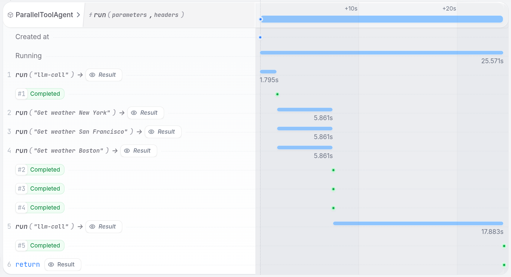

<!-- markdown-link-check-disable -->

<!-- markdown-link-check-enable -->

# Durable Agents and AI workflows with Restate

This repo contains a set of runnable examples of AI agents and workflows, using  **Durable Execution, state, and orchestration** via [Restate](https://restate.dev/) ([Github](https://github.com/restatedev/restate))

## Why Restate?

Restate is a durable runtime for agents and backends. It gives you:
- ✅ **Durable Execution**: Retry and recover from failures without repeating completed steps.
- ✅ **Durable Coroutines**: Run multiple tools, subagents, and sandbox commands in parallel with recovery and coordination.
- ✅ **State & session coordination**: Built-in multi-turn, persistent sessions. Scale out to thousands of concurrent sessions with built-in concurrency control
- ✅ **Communication & flow control**: Resiliently route tasks between distributed agents, humans, and MCP servers, and shape traffic with concurrency control
- ✅ **Observability & control**: Inspect detailed execution journals, and pause, cancel, kill, or roll back stuck agents
- ✅ **Production safety**: Approvals, timeouts, rollbacks, and escalation without callback plumbing

 
<caption><em>Restate UI showing an agent execution with parallel tool calls</em></caption>

## How to build agents with Restate?
There are three ways to build durable agents with Restate. **We recommend the first two:**

1. **[agentlib](agentlib/examples/README.md)**: Start here for initial proofs of concept, simple agents, or any agent whose logic fits agentlib's abstractions.
2. **Custom / DIY**: Build directly on Restate when you need custom agent logic or more control. Use the **[agent reference architecture](https://github.com/restatedev/agent)** as a starting point.
3. **An agent SDK integration**: Use Restate with frameworks such as Vercel AI, OpenAI Agents, Google ADK, Pydantic AI, or LangChain. See the templates and examples below.

The reference architecture is also useful for agents built with agentlib: its patterns for session management, queuing, steering, interruption, and approvals can help you build the surrounding application.

## Using AI coding tools

The [Restate plugin](https://github.com/restatedev/skills) provides coding skills and the Restate docs MCP server. The repository root, all standalone templates, and the agentlib examples include configuration for [Claude Code](.claude/settings.json) and [Codex](.codex/config.toml). The [shared marketplace catalog](.agents/plugins/marketplace.json) points to the published plugin.

Codex enables the plugin after you trust the project. See the [plugin installation instructions](https://github.com/restatedev/skills#install-plugin) for details.

## Quickstart Templates

Restate integrates with popular Agent SDKs and with all LLM SDKs (only abstracting away the LLM API).

| Integration | Quickstart | Template |
| ------------------------------------ | ------------------------------------------------------ | ---------------------------------------------------------------------------------------------------------------------- |
| **Restate agentlib** | [Setup](agentlib/template/README.md#run) |  |
| **TS DIY agents** | [📖](https://docs.restate.dev/ai-quickstart) |  |
| **Python DIY agents** | [📖](https://docs.restate.dev/ai-quickstart) |  |
| **Vercel AI SDK** | [📖](https://docs.restate.dev/ai-quickstart) |  |
| **OpenAI Agents SDK** | [📖](https://docs.restate.dev/ai-quickstart) |  |
| **Google ADK** | [📖](https://docs.restate.dev/ai-quickstart) |  |
| **Pydantic AI** | [📖](https://docs.restate.dev/ai-quickstart) |  |
| **LangChain** | [📖](https://docs.restate.dev/ai-quickstart) |  |

## Getting Started - Basic Examples

| Pattern | Docs | Restate agentlib | TS DIY agents | Python DIY agents | Vercel AI | OpenAI | ADK | Pydantic AI | LangChain |
| --------- | ------ | ----------- | --- | --- | ----------- | -------- | ----- | ------------- | ----------- |
| **Durable agents**: Build AI agents that survive crashes and recover automatically | [📖](https://docs.restate.dev/ai/patterns/durable-agents) |  |  |  |  |  |  |  |  |
| **Durable Sessions**: Persistent, isolated agent sessions | [📖](https://docs.restate.dev/ai/patterns/sessions) |  |  |  |  |  |  |  |  |
| **Human approvals with pause/resume**: Human approval steps that suspend execution | [📖](https://docs.restate.dev/ai/patterns/human-in-the-loop) |  |  |  |  |  |  |  |  |
| **Multi-agent orchestration**: Route requests to specialized agents | [📖](https://docs.restate.dev/ai/patterns/multi-agent) |  |  |  |  |  |  |  |  |

## Implementation Guides

### Orchestration Guides

| Pattern | Docs | Restate agentlib | TS DIY agents | Python DIY agents | Vercel AI | OpenAI | ADK | Pydantic AI | LangChain |
| ---------------------------------------------------------------------------------------------------------- | ------ | ----------- | --- | --- | ----------- | -------- | ----- | ------------- | ----------- |
| **Parallel tool calls**: Run multiple tools in parallel with recovery and coordination | [📖](https://docs.restate.dev/ai/patterns/parallelization) |  |  |  |  |  |  |  |  |
| **Sequential LLM calls**: Chain agents in multi-step pipelines | [📖](https://docs.restate.dev/ai/patterns/workflow-sequential) |  |  |  |  |  |  |  |  |
| **Parallel agents**: Executing multiple agents in parallel | [📖](https://docs.restate.dev/ai/patterns/workflow-parallel) |  |  |  |  |  |  |  |  |
| **Orchestrator-worker**: Break tasks into specialized subtasks | [📖](https://docs.restate.dev/ai/patterns/workflow-orchestrator) |  |  |  |  |  |  |  |  |
| **Evaluator-optimizer**: Generate, evaluate, improve loop | [📖](https://docs.restate.dev/ai/patterns/workflow-evaluator) |  |  |  |  |  |  |  |  |
| **Workflows as tools**: Complex tool logic as separate durable services | [📖](https://docs.restate.dev/ai/patterns/tools) |  |  |  |  |  |  |  |  |
| **Remote agents**: Deploy/scale agents separately with resilient RPC and queuing | [📖](https://docs.restate.dev/ai/patterns/remote-agents) |  |  |  |  |  |  |  |  |
| **Competitive racing agents**: Run parallel agents, use the fastest response, cancel others | [📖](https://docs.restate.dev/ai/patterns/competitive-racing) |  |  |  | - | - | - | - | - |
| **Interrupt & regenerate**: Interrupt a running agent with new context; cancel in-flight task and restart | - | - |  |  | - | - | - | - | - |

### Reliability Guides

| Pattern | Docs | Restate agentlib | TS DIY agents | Python DIY agents | Vercel AI | OpenAI | ADK | Pydantic AI | LangChain |
| --------- | ------ | ----------- | --- | --- | ----------- | -------- | ----- | ------------- | ----------- |
| **Error handling**: Retries and error handling for agents | [📖](https://docs.restate.dev/ai/patterns/error-handling) |  | - | - |  |  |  |  |  |
| **Rollback**: Saga pattern for compensating failed operations | [📖](https://docs.restate.dev/ai/patterns/rollback) | - | - | - |  |  | - | - | - |

### Frontend Integration

| Pattern | Docs | Restate agentlib | TS DIY agents | Python DIY agents | Vercel AI | OpenAI | ADK | Pydantic AI | LangChain |
| --------- | ------ | ----------- | --- | --- | ----------- | -------- | ----- | ------------- | ----------- |
| **Chat UI integration**: Integrate agents with chat UIs | [📖](https://docs.restate.dev/ai/patterns/chat-ui-integration) | - | - | - |  | - | - | - | - |
| **Streaming responses**: Stream agent responses to clients | [📖](https://docs.restate.dev/ai/patterns/streaming-responses) | - | - | - |  | - | - | - | - |
| **Notify when ready**: Callback when agent completes | [📖](https://docs.restate.dev/ai/patterns/notify-when-ready) | - | - | - | - |  | - | - | - |

## Integrations

### Protocols
| Example                                                                                                                                                      | Code |
|--------------------------------------------------------------------------------------------------------------------------------------------------------------|------|
| **MCP**: Using Restate for exposing tools and resilient orchestration of tool calls                                                                          |  |
| **A2A**: Implement Google's Agent-to-Agent protocol with Restate as resilient, scalable task orchestrator                                                    |  |

### AI Observability

| Integration | Restate agentlib | TS DIY agents | Python DIY agents | OpenAI Agents | Google ADK | Pydantic AI |
| ---------------------- | ----------- | --- | --- | ------------------------------------------------------------------------------------------------------------------------------------------------------ | -------------------------------------------------------------------------------------------------------------------------------------------------- | --------------------------------------------------------------------------------------------------------------------------------------------------- |
| **Langfuse** | - | - |  |  |  |  |
| **Arize Phoenix** | - | - | - |  | - | - |
| **Pydantic LogFire** | - | - | - | - | - |  |
| **Braintrust** | - |  | - | - | - | - |

### Others

| Example                                                                                                                                                      | Code |
|--------------------------------------------------------------------------------------------------------------------------------------------------------------|------|
| **NextJS Template**: Minimal example of Restate + AI SDK + NextJS                                                                                            |  |
| **NextJS Example App**: Example app of Restate + AI SDK + NextJS with tools, chat, pubsub,...                                                                |  |

## Advanced Examples

Larger, end-to-end applications (in separate repos) showing how Restate holds up in real-world agentic systems.

| Example                                                                                                                                                      | Code |
|--------------------------------------------------------------------------------------------------------------------------------------------------------------|------|
| **Agent reference architecture**: Custom agents with session management, queuing, steering, interruption, approvals, and parallel tools and subagents |  |
| **Coding agent**: orchestrates multi-turn conversations and coordinates subagents over sandboxed task execution                                              |  |
| **Deep Research Agent**: Autonomous multi-day research agent (news digests, human-approved plans, parallel investigations) with Restate + LangChain + Tavily |  |
| **Supervisor Agent**: Supervisor pattern with policy gates, audit trails, and escalation ladders for security remediation workflows                          |  |

## Supported Languages

Restate currently supports 6 languages:

The examples can be translated to any of the supported languages.
Join our [Discord](https://discord.restate.dev)/[Slack](https://slack.restate.dev) to get help with translating an examples to your language of choice.

## Learn more
- [AI Documentation](https://docs.restate.dev/ai)
- [Examples on workflows, microservice orchestration, async tasks, event processing](https://github.com/restatedev/examples)
- [Restate Cloud](https://restate.dev/cloud/)
- [Discord](https://discord.restate.dev) / [Slack](https://slack.restate.dev)
