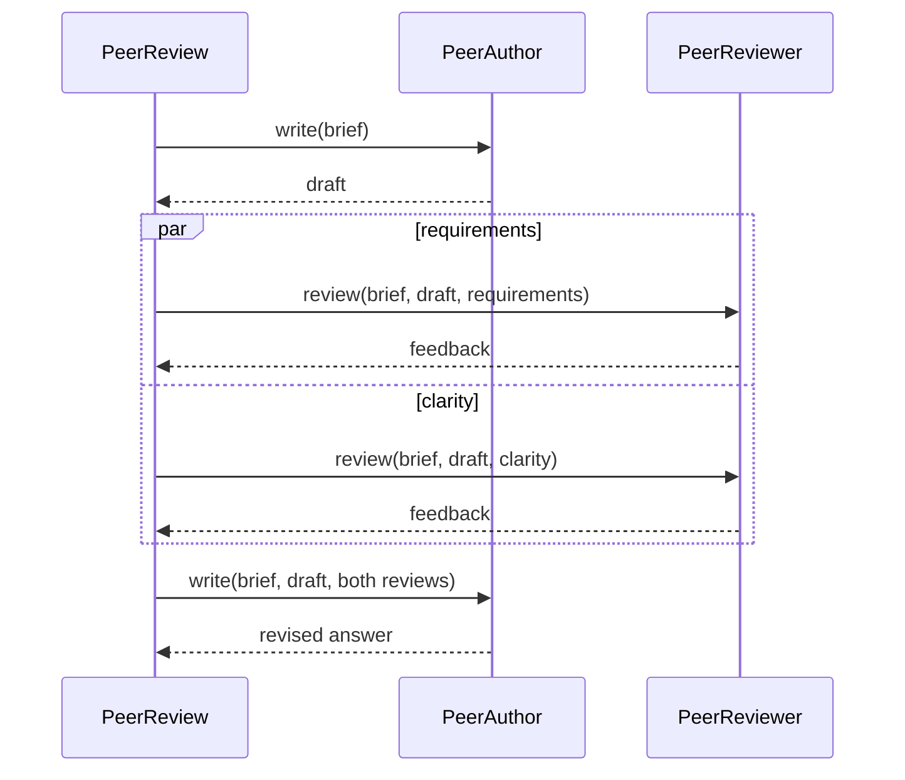

# agentlib examples

Examples of agents and workflows built with [Restate agentlib](https://github.com/restatedev/agentlib).
Each example runs on its own. Examples 01-10 cover the basics, from tool calls to
session management. The remaining examples cover coding agents, routing, and MCP.

| Example | Pattern                                 | Source                                                             |
| ------- | --------------------------------------- | ------------------------------------------------------------------ |
| 01      | A simple agent                          | [01_hello.ts](src/lessons/01_hello.ts)                             |
| 02      | A tool with validated arguments         | [02_tools.ts](src/lessons/02_tools.ts)                             |
| 03      | Conversation history between requests   | [03_conversation.ts](src/lessons/03_conversation.ts)               |
| 04      | Validated, typed output                 | [04_structured_output.ts](src/lessons/04_structured_output.ts)     |
| 05      | Code generation and review              | [05_evaluator_optimizer.ts](src/lessons/05_evaluator_optimizer.ts) |
| 06      | Human approval                          | [06_human_approval.ts](src/lessons/06_human_approval.ts)           |
| 07      | Concurrent agents                       | [07_racing_agents.ts](src/lessons/07_racing_agents.ts)             |
| 08      | Parallel research agents                | [08_research_report.ts](src/lessons/08_research_report.ts)         |
| 09      | Conversation and turn controls          | [09_support_session.ts](src/lessons/09_support_session.ts)         |
| 10      | Restate services as tools               | [10_service_tool.ts](src/lessons/10_service_tool.ts)               |
| 11      | A coding agent in a Modal sandbox       | [11_coding_agent.ts](src/lessons/11_coding_agent.ts)               |
| 12      | Route to a specialist                   | [12_routing.ts](src/lessons/12_routing.ts)                         |
| 13      | Enforce a tool policy                   | [13_tool_guardrail.ts](src/lessons/13_tool_guardrail.ts)           |
| 14      | Web search                              | [14_web_search.ts](src/lessons/14_web_search.ts) |
| 15      | Exchange feedback over durable RPC      | [15_peer_review_rpc.ts](src/lessons/15_peer_review_rpc.ts)         |
| 16      | Follow an agent's progress              | [16_progress_feed.ts](src/lessons/16_progress_feed.ts)             |
| 17      | Tools from a remote MCP server          | [17_mcp_tools.ts](src/lessons/17_mcp_tools.ts)                     |

## Start

[Code](src/app.ts)

Requires Node.js 22.21.1+, Docker for tests, a Restate server, and an OpenAI API key.
Run the following commands from this directory:

```sh
npm install
npm run build
export OPENAI_API_KEY=...
# Optional: export AGENT_MODEL=...
npm run dev
```

Start Restate in another terminal:

```sh
npx @restatedev/restate-server
```

Register the endpoint:

```sh
npx @restatedev/restate deployments register http://localhost:9080
```

The app serves the Restate endpoint on port 9080. The Restate UI is at http://localhost:9070. Run the template and
example app separately because they use the same service port.

```sh
npm run build
npm test
```

Tests use a real Restate container with always-replay enabled and fixture model
responses. They do not require API keys or make paid model calls. The coding
agent test substitutes a temporary local directory for Modal.

## 01 - Simple agent

[Code](src/lessons/01_hello.ts)

A simple agent defined with `agent({model})` and exposed as a Restate handler.
Each request starts a new conversation and returns the agent's answer as a JSON string.

```sh
curl --globoff "localhost:8080/Hello/ask" --json '{"message":"Say hello in one sentence."}'
```

The handler returns the answer, for example `"Hello!"`. 

## 02 - Tool calls

[Code](src/lessons/02_tools.ts)

An agent with instructions and a `lookupTicket` tool. The tool uses Zod to define
its input and returns a demo ticket. The agent decides when to call the tool.

```sh
curl --globoff "localhost:8080/TicketLookup/ask" \
  --json '{"message":"What is the status of ticket T-42?"}'
```

`asyncTool` wraps an async function and journals its result. You can replace the
demo ticket with an API call. The callback's second argument provides application
context, call metadata, and an `AbortSignal` for cancelling I/O.

The tool retries failed calls up to five times, with a delay starting at 250 ms
and doubling after each attempt.

Use `tool` with `yield*` when you need to call other agentlib operations inside a
tool. Use `handlerTool` to call a Restate handler.

## 03 - Conversation history

[Code](src/lessons/03_conversation.ts)

A chat agent that stores conversation history in a Restate virtual object.
The handler loads the messages before each run and saves `result.messages` afterward.

```sh
curl --globoff "localhost:8080/ChatSession/bob/ask" --json '{"message":"My name is Bob."}'
curl --globoff "localhost:8080/ChatSession/bob/ask" --json '{"message":"What is my name?"}'
```

Both requests use the key `bob`, so they share a conversation. Each key has its
own history. This example stores all messages. Example 09 also shows conversation
compaction, steering, and interruption.

## 04 - Structured output

[Code](src/lessons/04_structured_output.ts)

An agent that classifies support tickets. The `output` schema defines the response
format, and agentlib validates the model's answer against it.

```sh
curl --globoff "localhost:8080/TicketTriage/classify" \
  --json '{"message":"I was charged twice for my subscription."}'
```

The handler returns the classification directly, for example:
`{"category":"billing","summary":"The customer reports a duplicate subscription charge."}`.
Example 05 uses structured output to pass results between two agents.

## 05 - Code generation and review

[Code](src/lessons/05_evaluator_optimizer.ts)

One agent generates code and another reviews it. The handler passes the feedback
back to the first agent until the reviewer approves the code or three attempts
have been made. Each agent run has its own name.

```sh
curl --globoff "localhost:8080/CodeReview/generate" \
  --json '{"task":"Read the first item of an array safely, returning undefined when it is empty."}'
```

The handler returns the approved code. After three rejected drafts, it returns
the latest code and feedback. The reviewer is an LLM; this example does not execute
the generated code. A stopped or interrupted run throws a `TerminalError`.

Each draft starts a new agent run. A run can include multiple steps, with one
planning model call per step. See the
[agentlib glossary](https://github.com/restatedev/agentlib/blob/main/CONTEXT.md) for more details.

## 06 - Human approval

[Code](src/lessons/06_human_approval.ts)

A ticket agent that waits for human approval before calling `closeTicket`.
The tool sets `needsApproval: true` and simulates closing a ticket.

Start a request in one terminal:

```sh
curl --globoff "localhost:8080/TicketApproval/bob/ask" \
  --json '{"message":"Close ticket T-42."}'
```

Before calling the tool, agentlib calls `onApproval(request)` and waits for a
durable signal. The callback logs a curl command with the invocation ID, signal
name, and approval decision filled in. Copy that command from the app's terminal
and run it in another terminal.

The command calls `TicketApproval/<key>/approve` with `approved: true`.
Change it to `false` to reject the tool call. The handler sends the decision to
the waiting agent, and the original `ask` request returns the agent's reply.
The approval request is not stored in object state. In an application, you could
send it to a reviewer by email or through a ticketing system instead.

## 07 - Racing agents

[Code](src/lessons/07_racing_agents.ts)

Two agents run in parallel, and `restate.any` returns the first successful answer.
The handler interrupts the other agent and waits for its cleanup to finish.
If both agents fail, the handler returns a terminal error.

```sh
curl --globoff "localhost:8080/RacingAgents/answer" \
  --json '{"question":"How should a durable workflow handle external side effects?"}'
```

Both agents use the same model with different instructions. Change their `model`
fields to compare providers. Running both agents can use more tokens than a single run.

## 08 - Parallel research agents

[Code](src/lessons/08_research_report.ts)

A planner splits a research topic into 2-4 questions and calls a `ResearchWorker`
for each question in parallel. The workers read the supplied sources through tools,
and the planner combines their findings into a report. Workers can only cite sources
they have read. Cancelling the parent also cancels unfinished worker calls.

```sh
curl --globoff "localhost:8080/ResearchReport/generate" --json '{
  "topic": "Explain recovery and external side effects",
  "sources": [
    {
      "id": "journal",
      "title": "Durable execution",
      "text": "Restate journals completed operations and reuses their results during replay."
    },
    {
      "id": "effects",
      "title": "Idempotency",
      "text": "An external effect can repeat if its result was not committed. Use stable idempotency keys for external mutations."
    }
  ]
}'
```

The handler returns the final report. This example uses the documents in the
request. The citation check verifies that workers
read the sources they cite, but does not check whether their conclusions are correct.

## 09 - Session management

[Code](src/lessons/09_support_session.ts)

A support agent with one conversation per object key. `doTurn` processes one turn
at a time, saves the messages, and compacts long conversations. Shared handlers let
you control the agent while it runs:

- `status`: Get the active turn.
- `steer`: Add a message to the running turn.
- `interrupt`: Stop the turn and return a summary.
- `approve`: Approve or reject a tool call.

The ticket tools use demo data.

```sh
curl --globoff "localhost:8080/AiSession/bobb/doTurn" \
  --json '{"message":"Look up ticket T-42, then close it."}'
```

`doTurn` returns the answer or interruption summary. Use `history` to read the
conversation. When a tool needs approval, the app logs a curl command for
`AiSession/<key>/approve` with the right JSON. Run it in another terminal to
approve, or change `approved` to `false` to reject. Approval requests are not
stored in the session state.

## 10 - Restate services as tools

[Code](src/lessons/10_service_tool.ts)

`serviceTool(refundIface)` exposes a Restate service as a tool. The model chooses
between `getPolicy` and `issueRefund` using the handler descriptions and input
schemas from the interface. To expose only one handler, pass
`{iface, handler: "issueRefund"}`. For virtual objects and workflows, also pass a `key`.

```sh
curl --globoff "localhost:8080/RefundAgent/ask" \
  --json '{"message":"Refund order O-99 for $12.50 and tell me the refund policy."}'
```

Tool calls run as durable child invocations. Interrupting the agent cancels
unfinished calls. Handler failures are returned to the model as tool errors.

## 11 - Coding agent with Modal

[Code](src/lessons/11_coding_agent.ts)

`CodingAgent` gives an agent three tools, `readFile`, `writeFile`, and
`runCommand`, backed by a [Modal Sandbox](https://modal.com/docs/guide/sandbox).
The handler opens a sandbox, runs the agent, and releases the sandbox.

`connect` creates the sandbox and journals its ID, so replay reuses the same
sandbox. It wraps the ID in a Modal `Sandbox` handle and passes it to the tools
through the run context. `release` terminates the sandbox in a journaled step.
The `finally` block also runs cleanup when the agent fails.

All three tools use `asyncTool` to journal their results. `runCommand` makes one
attempt and returns failures to the model.

Authenticate with `modal token new`, or set `MODAL_TOKEN_ID` and
`MODAL_TOKEN_SECRET`, then:

```sh
curl --globoff "localhost:8080/CodingAgent/ask" \
  --json '{"task":"Write primes.js that prints the first 10 primes, then run it."}'
```

## 12 - Routing

[Code](src/lessons/12_routing.ts)

A routing agent selects `billing`, `account`, or `product` using structured output.
The handler then calls the selected specialist.

```sh
curl --globoff "localhost:8080/SupportRouter/answer" \
  --json '{"question":"I cannot log into my account. How can I regain access?"}'
```

Each specialist starts a new run with the question. To transfer the current run
and conversation history to another agent, use `handoff`.

## 13 - Tool guardrails

[Code](src/lessons/13_tool_guardrail.ts)

A hotel booking tool with a budget check in `before`. The check uses the quote
and budget from application context. The model selects a hotel ID, but cannot
change the price. If the check rejects the call, the model receives the reason.

```sh
curl --globoff "localhost:8080/GuardedBooking/ask" \
  --json '{"hotelId":"H-42","quotedTotalCents":12500,"maxTotalCents":10000}'
```

Set `maxTotalCents` to `15000` to allow the booking. This example returns a demo
reservation. For a real booking, fetch the quote from your own service.

## 14 - Web search

[Code](src/lessons/14_web_search.ts)

An agent that calls the Tavily search API through an `asyncTool`. The tool
journals the results, so replay does not repeat completed searches. It retries
rate limits and server errors, and returns other HTTP errors to the model.
Results include up to five sources with titles, URLs, and trimmed snippets.

Set `TAVILY_API_KEY` in the terminal running the app, then start or restart it.
The API key stays in the tool and is never passed to the model.

```sh
export TAVILY_API_KEY=...
curl localhost:8080/WebResearch/answer \
  --json '{"question":"Find the Restate TypeScript SDK docs and cite their URLs."}'
```

## 15 - Agent communication over RPC

[Code](src/lessons/15_peer_review_rpc.ts)

`PeerReview` calls `PeerAuthor` to write a draft, then calls two `PeerReviewer`
instances in parallel. It sends both reviews back to the author for a revision.
Each agent is a Restate service, communicating through typed RPC calls:



```sh
curl --globoff "localhost:8080/PeerReview/answer" \
  --json '{"brief":"Write a two-sentence release note for a feature that retries transient failures and resumes completed steps from a journal."}'
```

The handler returns the revised answer. Restate journals each RPC, so replay
reuses completed author and reviewer calls.

## 16 - Progress events

[Code](src/lessons/16_progress_feed.ts)

The agent sends progress events to a `ProgressFeed` object through `onProgress`.
The shared `subscribe` handler waits for the next event. Events are not stored,
so subscribe before starting the agent. Subscribe again for each subsequent event.

```sh
curl --globoff --request POST "localhost:8080/ProgressFeed/audit-1/subscribe" &
curl --globoff "localhost:8080/InventoryAudit/audit" --json '{"job":"audit-1"}'
```

## 17 - MCP tools

[Code](src/lessons/17_mcp_tools.ts)

`mcpTools` loads tools from a remote MCP server and journals the tool list and
call results. This example uses the [Restate docs MCP server](https://docs.restate.dev/mcp).

```sh
curl "localhost:8080/DocsGuide/ask" --json '{"question":"What is a virtual object?"}'
```
